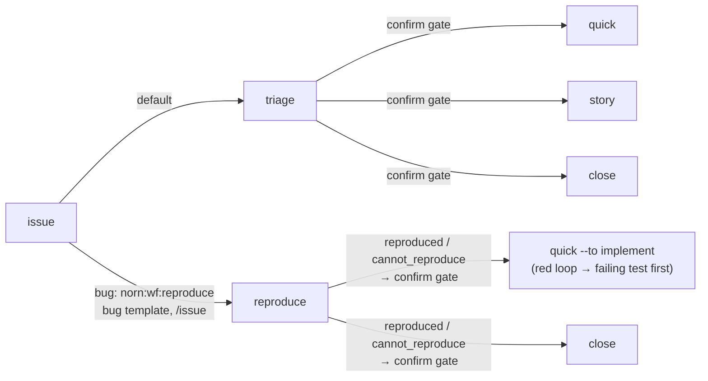

## Summary

Intake now goes by kind of issue. `triage` handles stories and features and recommends `quick | story | close`. A bug starts in a new read-only `reproduce` workflow, and `quick` fixes it from the red loop that `reproduce` posted. The `fix` and `spec` workflows are gone.



```text
.agents/norn/workflows/
  triage.yaml     # outcomes quick | story | close (fix, spec dropped)
  reproduce.yaml  # new: one norn-diagnose step, posts `## Reproduce` comment, confirm gate
  quick.yaml      # implement starts from reproduce's red loop when there is one
  fix.yaml        # deleted
  spec.yaml       # deleted; PRD changes go through story (refine) or quick
```

## Evidence

None of this ran through QA (a `quick` story has no QA step). What backs it is the repo tests and review#1 (approve): `bun test` 1239 pass, typecheck green.

- **triage for stories and features only, outcomes `quick | story | close`**
  **Before:** `fix | quick | story | spec | close`.
  **After:** `test/repo.test.ts`, "intake by kind": `keys(triage.explore.outcomes) == [close, quick, story]` and `confirm` is a gate. The gate prompt now lists `quick`, `story` and, for a bug, `reproduce`.
- **New `reproduce` workflow, read-only, `norn-diagnose`, outcomes to a `confirm` gate**
  **Before:** did not exist (reproducing was the first step of `fix`).
  **After:** the test checks `start == reproduce`, `steps == [confirm, reproduce]`, `skill == norn-diagnose`, `{reproduced, cannot_reproduce} → confirm`, `confirm.approve == $done`. The instructions allow one remote write, the `## Reproduce` issue comment, and change no file. That the step behaves this way on a real bug has **not been shown**: nothing has run it yet. The first labelled bug will show it.
- **`quick`'s implement turns the red loop into a failing test first**
  **After:** the test checks that `quick.implement.instructions` mentions `## Reproduce`. Whether an agent follows that is not shown and depends on the agent.
- **`fix.yaml` and `spec.yaml` deleted**
  **After:** `test/process.test.ts`: the repo workflows include `triage, reproduce, story, quick, release`, and none is named `fix` or `spec`. Every remaining workflow still validates. The full-suite check line that only `fix` had is gone from `test/repo.test.ts`.
- **Routing: bug report template applies `norn:wf:reproduce`, the `issue` skill sets it for bugs**
  **After:** the test checks that the `bug_report.md` frontmatter has `labels == ["norn:wf:reproduce"]`. `.agents/skills/issue/SKILL.md` sets the label for bugs. **Not done:** the `norn:wf:reproduce` label does not exist on GitHub yet, because the agent may not write to the remote. Until it exists, GitHub drops the label from the template and a bug falls back to `triage`. Run `gh label create norn:wf:reproduce` before or right after merging.
- **Changelog mapping in the `release` skill**
  **After:** the table maps `reproduce` (the story's first workflow, read from its label) to Fixed. The `fix` and `spec` rows are gone. Docs only, no test.
- **Docs: AGENTS.md, CONTRIBUTING.md, `triage` / `issue` skills**
  **After:** these docs now describe the intake split, the label set and "a PRD change goes through `story` or `quick`". Review noted two loose ends that are not fixed in this PR:
  - `CONTRIBUTING.md:12` still says "Every workflow ends at a `ready` gate", which is no longer true for `triage` and `reproduce`.
  - The `triage` skill's bug-without-label line recommends `quick` but gives the `Run:` line for `reproduce`.

## Merge danger

**Door:** two-way: workflow YAML, skills and docs only, no persisted format or code changes. A revert brings `fix` and `spec` back. The one thing a revert leaves behind is the `norn:wf:reproduce` label, if it was created.

**Blast radius:** this repo's process: a story that is currently in `fix` or `spec` loses its workflow definition when this merges. Check `norn inbox` first and switch any such story (`norn workflow gh-N quick --to implement`) or finish it before merging. Until the label exists, bugs quietly go to `triage`.
