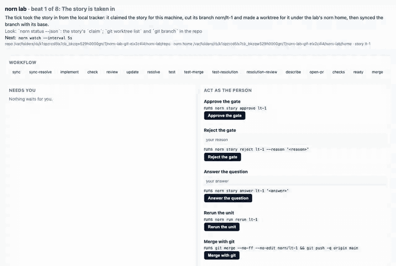

<p align="center">
  
</p>

<h1 align="center">norn</h1>

<p align="center">
  <strong>Hand software stories to coding agents, and always know what is waiting for you.</strong>
</p>

<p align="center">
  <a href="https://github.com/PruszynskiJakub/norn-next/actions/workflows/ci.yml"></a>
  <a href="https://github.com/PruszynskiJakub/norn-next/releases"></a>
  
</p>

> [!NOTE]
> norn is pre-1.0: a minor version can change the machine contract (JSON output, persisted formats, the plugin API), and [`CHANGELOG.md`](CHANGELOG.md) says what changed. It ships with Claude Code and pi as agent tools.

You give a story to a coding agent and switch to something else. Forty minutes later you look back: the agent has been waiting on a question in a pane you closed. Or it died halfway through. Or it ran the same failing test three times, said it was done, and nothing checked.

**norn delivers stories with coding agents one bounded step at a time, and tells you what needs you.** You label an issue (or write an item in a local tracker). norn takes it in, gives it a branch and a worktree, and walks it through a workflow: refine the spec, plan, implement in slices, test, review, QA, open a draft PR. Agents do the steps. Plain code decides what comes next, notices when an agent asks, dies or stalls, and shows you the command that answers it.

norn is a small kernel and plugins. Where stories come from (GitHub issues, or markdown files on your machine), where changes are reviewed (GitHub pull requests, or plain git), where run data lives, which agent tool works (Claude Code, pi) and where it runs (headless, or a Herdr pane) are each a plugin you pick in the config; `norn init` picks them for you.

## Try this

Once norn is [installed](#install), see a whole story go through in a few minutes, for free and offline:

```sh
norn lab
```

`norn lab` builds a throwaway repo under your temp directory, with its own norn home, a toy app and a stand-in agent, so no real agent runs and nothing of yours is touched. A story plays through the `quick` workflow in eight beats: taken in, a failing check, a question for you, a review loop, a dead agent retried, a pull request, a gate you reject and approve, and a merge. It prints the URL of a dashboard on localhost (it opens no browser): the workflow graph with the live step lit, each decision in plain words, the receipts in the order they were written, what needs you, the story's documents and the agent's session. Its buttons run the real commands (`norn story answer`, `norn story approve`, the git merge) and show each one. `norn lab --clean` or the Reset button starts it again from beat 1; `--port <n>` picks the port.



## Is norn for you?

**A good fit today:** one person, Claude Code or pi, a test suite you trust, and stories big enough to plan. GitHub works out of the box; a repository with no code host works too, with the local tracker and no forge. Several stories can run in parallel on one machine, started by you (manual mode) or by norn (auto mode).

**Not yet, or not at all:** quick interactive edits (norn works per story, on a heartbeat), teams that require linear history on every branch (norn merges the base into story branches and never rebases), and two machines driving one story in real use. [Limitations](docs/limitations.md) lists all of it.

## Install

You need git ≥ 2.38 and an agent CLI (`claude` or `pi`) on `PATH`; for GitHub, `gh` signed in.

**Single-file binary** (no Bun, no token). Each release carries `norn-darwin-arm64`, `norn-darwin-x64`, `norn-linux-x64`, `norn-linux-arm64` and `SHA256SUMS`:

```sh
curl -fsSLO https://github.com/PruszynskiJakub/norn-next/releases/latest/download/norn-darwin-arm64
sudo install -d /usr/local/bin           # missing on a fresh Apple Silicon Mac
sudo install -m 755 norn-darwin-arm64 /usr/local/bin/norn
sudo codesign --force --sign - /usr/local/bin/norn   # macOS: a recent macOS kills it on start (exit 137) until it is signed here
norn --version
```

**From GitHub Packages** (npm). The package needs [Bun](https://bun.sh) ≥ 1.3 on `PATH`, and GitHub's npm registry asks for a token even to install: create a personal access token (classic) with the `read:packages` scope, then:

```sh
echo "@pruszynskijakub:registry=https://npm.pkg.github.com" >> ~/.npmrc
echo "//npm.pkg.github.com/:_authToken=<your token>" >> ~/.npmrc
bun add -g @pruszynskijakub/norn      # or: npm install -g @pruszynskijakub/norn
```

## Set up a repository

```sh
cd your-repo
norn init
```

`norn init` looks at the repository and the machine and writes one config file with every choice named:

- **tracker** `github` when `origin` is on GitHub and `gh` is installed, else `local`;
- **forge** `github` with the GitHub tracker, else `none`;
- **store** `local` (run data in `~/.norn/repos/<id>/`);
- **executor** `claude` when Claude Code is on `PATH`, else `pi`, running in the `headless` runner (`herdr` when you ask, inside Herdr). An attended step, which you work through beside the agent (the refinement workflow's), runs only in a runner with presence: in the headless runner it waits for one ([Executors and runners](docs/reference.md#executors-and-runners));
- **mode** `auto` with the headless runner, `manual` with Herdr;
- **base** the remote's default branch.

Every choice can be given as a flag instead (`--tracker`, `--forge`, `--store`, `--executor`, `--runner`, `--mode`). It writes `.agents/norn.local.yaml` and keeps `.agents/` out of git; with `--commit` it writes `.agents/norn.yaml` for the team to commit instead, puts your mode in `.agents/norn.local.yaml` (the committed file wins over everyone's own, so it leaves the mode to each person) and keeps only that file out of git. It writes the test command it finds in your build files as `checks.test`, which the workflows' test steps run, and for a JS repo its install as `setup`, which norn runs once in each new worktree ([Worktree setup](docs/reference.md#worktree-setup)). Then it runs `norn doctor`, which checks the config, the plugins, the workflows, the labels norn puts on issues (defining any the repository lacks), the harness hooks and the tools on `PATH`, writes the pack's skills into your checkout (`/norn-fsd`, `/norn-retro` and the rest, ignored by git; `norn doctor` brings them up to date after an upgrade), and names the first thing to fix.

Config comes in layers, each overriding the one before: norn's defaults, `~/.norn/config.yaml` (you, on every repository), `.agents/norn.local.yaml` (you, here) and `.agents/norn.yaml` (the team). `norn config show` prints what is in effect and which file set it; `norn config set <key> <value>` changes one key. More in [Concepts: Config](docs/concepts.md#config).

A plugin that does not ship with norn is one command: `norn plugin add <npm spec | git URL | path>` installs it and pins it in the repository's plugin lock; `norn plugin list` shows every plugin and what it provides.

## Run a first story

On GitHub, an issue labelled `norn` and assigned to you is a story; with the local tracker, `norn story create` makes one. `norn workflow list` shows every workflow you can start and when to pick it, `norn workflow show <name>` one workflow as norn runs it, and `norn skill list` every skill an agent here can use; all three work before `norn init` too, on the pack alone.

Before you start `norn watch`: in auto mode, which `norn init` writes with the headless runner, each agent step launches an agent on its own, and every agent run costs money on your harness's account. To start in manual mode instead, where nothing launches until you say so, run `norn config set kernel.mode manual` first; then `norn status` shows each agent step waiting and `norn run start <unit>` starts it. `norn watch` runs the ticks for you, one after another, so a story moves on by itself until something waits for you; a hand `norn tick` moves it one small step and stops.

```sh
gh issue create --label norn --assignee @me --title "Add CSV export of orders"
# or, with the local tracker:
norn story create "Add CSV export of orders" --workflow quick
norn watch     # the heartbeat: keep it running; Ctrl-C finishes the current tick
norn status    # in another terminal: every story, what needs you first
```

1. The next tick takes the item in as story `gh-N` (`lt-N` locally): a branch, a worktree, and the workflow its label `norn:wf:<name>` names (else `story`).
2. Each agent step starts on its own in auto mode; in manual mode `norn status` shows it waiting and `norn run start <unit>` starts it. The agent reads its brief with `norn brief`, works in the story's worktree and reports once with `norn done`, `norn ask` or `norn stuck`; the next tick moves the story on.
3. When an agent asks, `norn story answer <story> "…"` answers it. When a gate waits, `norn story approve <story>` or `norn story reject <story> --reason "…"` decides it. `norn story view <story>` shows one story in full. A unit that ended stuck runs its step again with `norn run rerun <unit>` once you fixed the cause (`--step <step>` to send it elsewhere).
4. A delivery workflow opens a draft PR; once you approve it at ready, norn marks it ready for review and waits for you to merge it. The merge ends the story: norn closes the issue, removes the worktrees and gives up its claim. A round that ends without a PR (`triage`, `refinement`, `reproduce`, or `fix` when the bug would not reproduce) leaves the issue open; `norn story round <story> --workflow <name>` starts the next one. When an open PR of a finished story conflicts with its base or lags it, `norn story update-branch <story>` merges the base in and pushes. The PR holds only code; the spec, the handoffs and norn's run data stay out of the branch ([Concepts: The agent's worktree](docs/concepts.md#the-agents-worktree)).

`norn help` lists every command; `norn help <command>` shows one.

## Where to go next

| Doc | For |
|---|---|
| [Concepts](docs/concepts.md) | how norn works: the kernel and its plugins, stories, units, workflows, steps, gates, modes, one tick, the agent's worktree, config, and the glossary |
| [Reference](docs/reference.md) | every command, flag and config key, the workflows the bundled pack ships, and the exit codes |
| [Workflows](docs/workflows.md) | every workflow the bundled pack ships, drawn as a graph: its steps, outcomes, limits and gates |
| [Recipes](docs/recipes.md) | what to do when an agent asks or dies, a gate waits, you want your own workflow or plugin, or you run without GitHub |
| [Limitations](docs/limitations.md) | what is not built, not proven in real use, or out of scope by design |
| [Contributing](CONTRIBUTING.md) | how norn is built with norn, and how to propose a change |

## Contributing

norn is built with norn. Start with [`CONTRIBUTING.md`](CONTRIBUTING.md).

## Credits

The `norn-codebase-design` and `norn-tdd` skills and the approach of the step skills are adapted from [mattpocock/skills](https://github.com/mattpocock/skills) (MIT), by way of the earlier norn; `norn-pr`, `norn-diagnose`, `norn-prototype` and `norn-retro` are adapted from its `pr`, `diagnosing-bugs`, `prototype` and `retro` skills directly.
