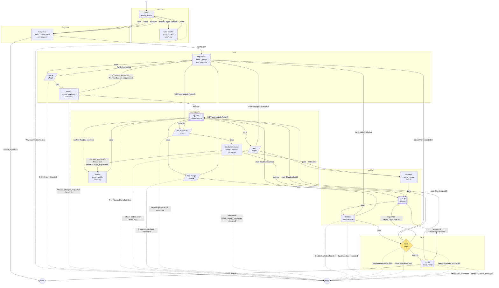
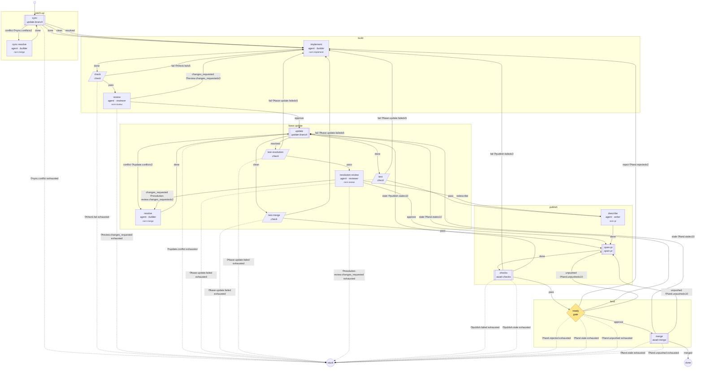
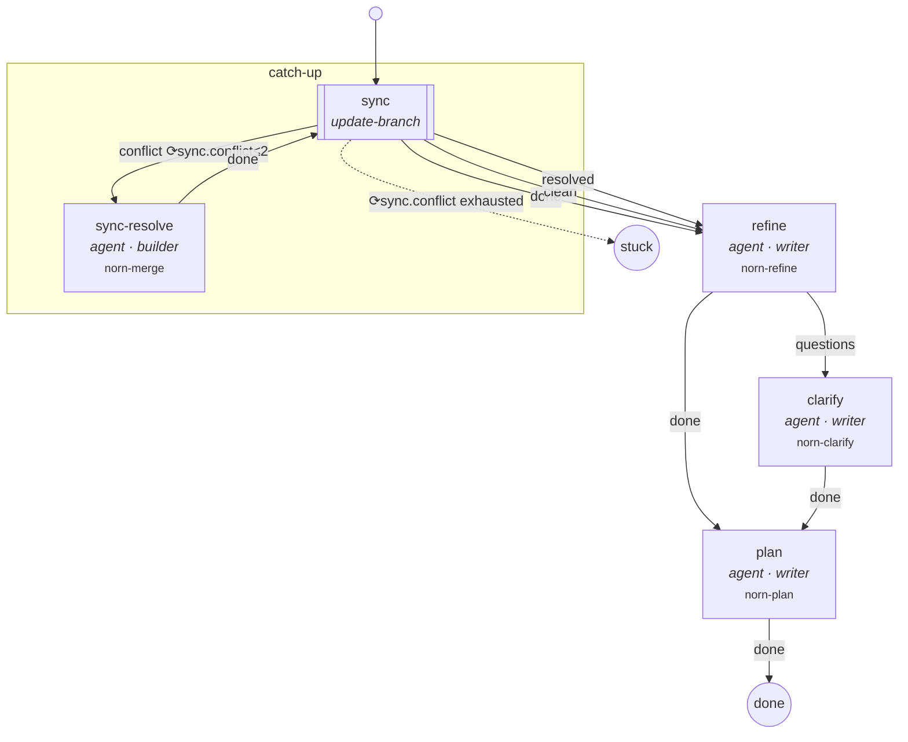
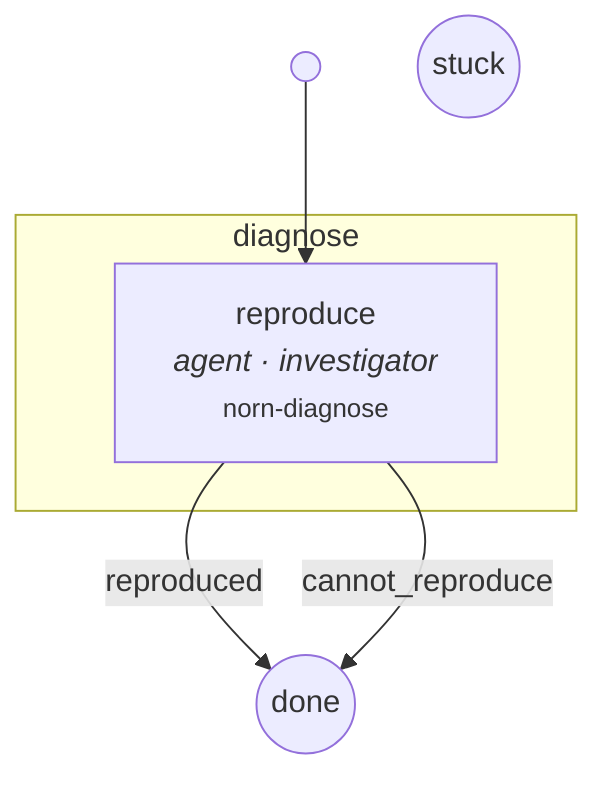
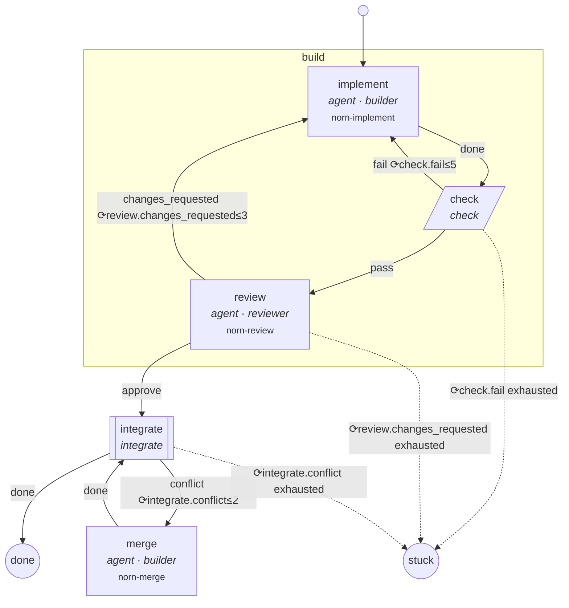
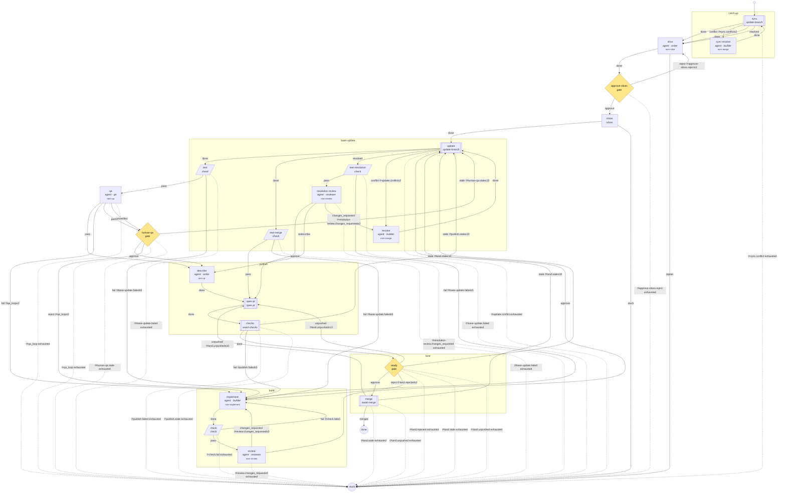
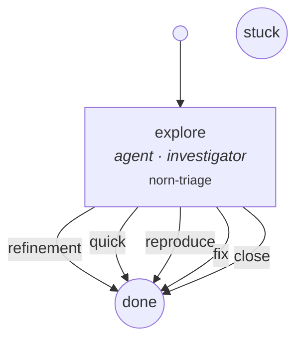

# Workflows

The shape of every workflow the bundled pack ships: its steps, where each outcome goes, the limits that send a story to stuck and the gates where a person decides. The graphs between the two marker comments are generated from the workflow loader (`bun run docs:emit`), so they match the release this file ships with. Each workflow's text and how to write one are in the [Reference](reference.md); what the terms mean is in [Concepts](concepts.md). In a repo, `norn workflow show <name> --mermaid` draws a workflow the same way, the repo's own files and overrides included, and `norn workflow list` names them all.

<!-- norn:workflows:start — generated by `bun run docs:emit`; edit the workflows, not this block -->

The `sdlc` pack's workflows, drawn from the workflow loader. A box is an agent step (its role and skill), a parallelogram a check, a double box a plugin step kind and a highlighted diamond a person's gate. A labelled box around steps is a shared file the workflow uses. An edge is an outcome; `⟳counter≤max` says it counts toward a limit, and the dashed edge from the same step goes to stuck when that limit runs out.

## `fix`

For a bug whose fix looks small and settled: reproduce it and confirm its cause, fix it test-first, review it, open the draft PR, wait for CI.

## `quick`

For a refactor, docs, a chore or another small change, or the fix of a bug a reproduce round confirmed: make it, check and review it, open the draft PR, wait for CI.

## `refinement`

For a story that needs a spec and a plan before code: agree them with a person against the current base; no code. The next round is story or quick.

## `reproduce`

For a bug whose cause a person wants before anyone fixes it: reproduce it through the real interface, confirm its cause and the seam for a regression test; change no code. The next round is fix, quick or refinement.

## `slice`

Runs on each slice a story workflow cuts, never started by hand: build the slice test-first, check and review it, and integrate it into the story branch.

## `story`

For a story a refinement round planned: slice it against the current base, run the slices, verify the story, open the draft PR, wait for CI.

## `triage`

The first round of a new issue: check it still holds, add its context, and end with the next round it recommends (refinement, quick, reproduce, fix) or closing it.

<!-- norn:workflows:end -->
