# Workflows

The shape of every workflow the bundled pack ships: its main path, the shared parts it uses, each drawn on its own, where each outcome goes, the limits that send a story to stuck and the gates where a person decides. The graphs between the two marker comments are generated from the workflow loader (`bun run docs:emit`), so they match the release this file ships with. Each workflow's text and how to write one are in the [Reference](reference.md); what the terms mean is in [Concepts](concepts.md). In a repo, `norn workflow show <name> --mermaid` draws a workflow's main graph the same way, the repo's own files and overrides included, and `norn workflow list` names them all.

<!-- norn:workflows:start — generated by `bun run docs:emit`; edit the workflows, not this block -->

The `sdlc` pack's workflows, drawn from the workflow loader. Each reads left to right along its main path, from its first step to done; a long path wraps into rows, each starting where the one before ends, and `→ name` marks where an edge goes on in another row. A box is an agent step (its role), a parallelogram a check, a double box a plugin step kind and a highlighted hexagon a person's gate. A rounded blue node is a shared part the workflow uses; its own graph follows the workflow's. A dotted line loops back to the left, labelled `← outcome` with the outcome that takes it; `⟳ outcome ≤max` on a step says that outcome counts toward a limit, and the story goes stuck when the limit runs out.

## `fix`

For a bug whose fix looks small and settled: reproduce it and confirm its cause, fix it test-first, review it, open the draft PR, wait for CI.

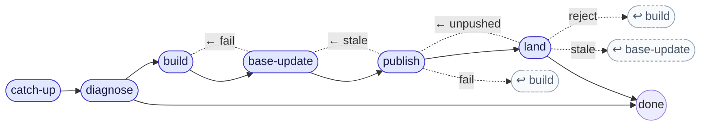

### `fix` › `catch-up`

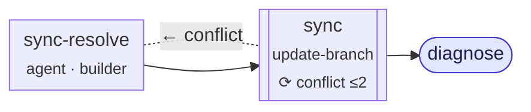

### `fix` › `diagnose`

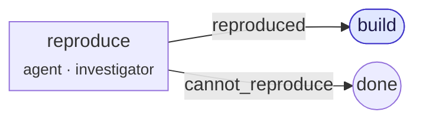

### `fix` › `build`

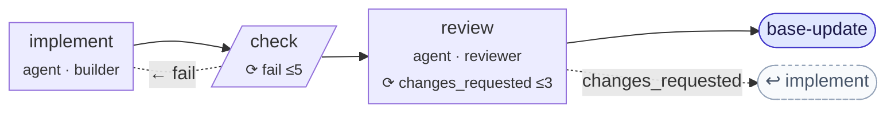

### `fix` › `base-update`


### `fix` › `publish`


### `fix` › `land`


## `quick`

For a refactor, docs, a chore or another small change, or the fix of a bug a reproduce round confirmed: make it, check and review it, open the draft PR, wait for CI.

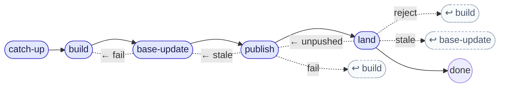

### `quick` › `catch-up`

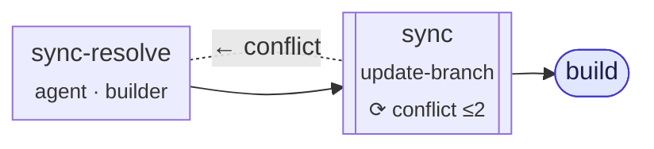

### `quick` › `build`


### `quick` › `base-update`

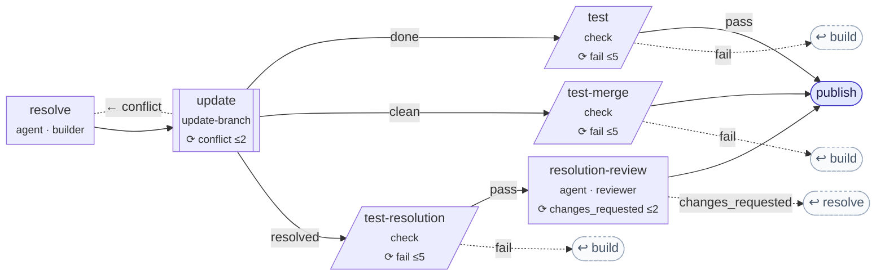

### `quick` › `publish`

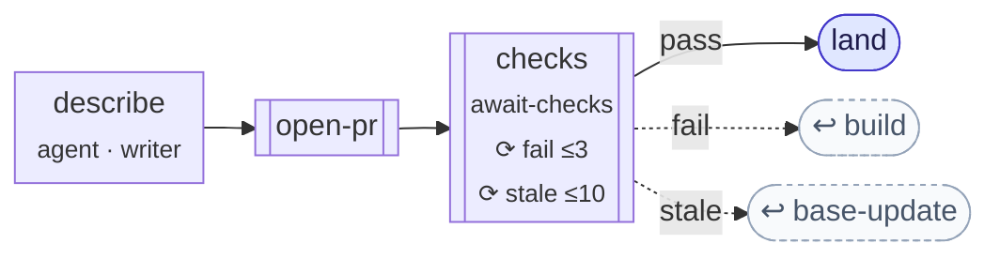

### `quick` › `land`

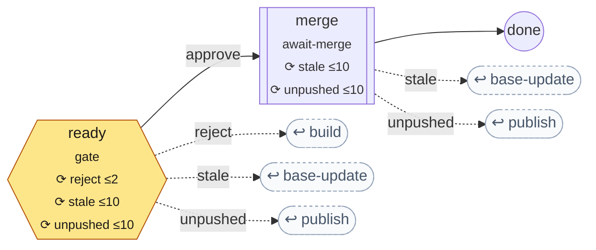

## `refinement`

For a story that needs a spec and a plan before code: agree them with a person against the current base; no code. The next round is story or quick.

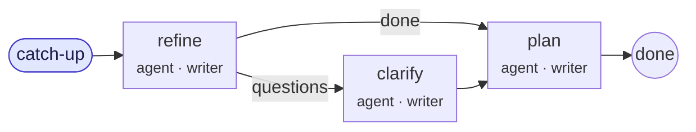

### `refinement` › `catch-up`

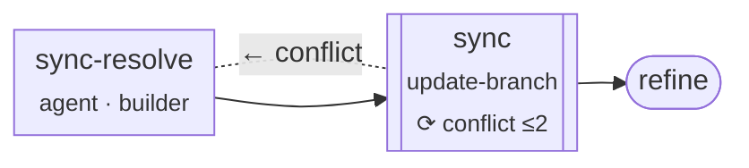

## `reproduce`

For a bug whose cause a person wants before anyone fixes it: reproduce it through the real interface, confirm its cause and the seam for a regression test; change no code. The next round is fix, quick or refinement.

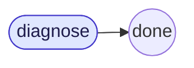

### `reproduce` › `diagnose`

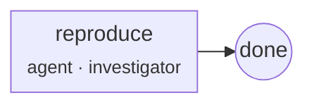

## `slice`

Runs on each slice a story workflow cuts, never started by hand: build the slice test-first, check and review it, and integrate it into the story branch.

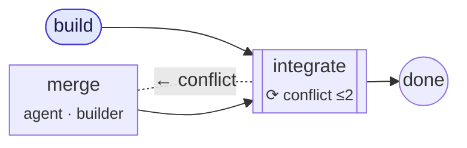

### `slice` › `build`

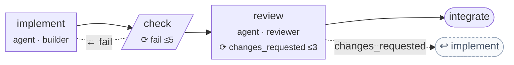

## `story`

For a story a refinement round planned: slice it against the current base, run the slices, verify the story, open the draft PR, wait for CI.

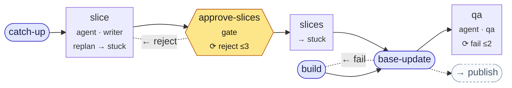

```mermaid
%%{init: {"flowchart": {"rankSpacing": 28, "nodeSpacing": 16, "padding": 6}}}%%
flowchart LR
  s_qa["qa<br/><small>agent · qa</small><br/><small>⟳ fail ≤2</small>"]
  s_human_qa{{"human-qa<br/><small>gate</small><br/><small>⟳ reject ≤2</small><br/><small>⟳ stale ≤10</small>"}}
  u_publish(["publish"])
  u_land(["land"])
  DONE(("done"))
  s_qa -->|"pass"| u_publish
  b_s_qa_u_build(["↩ build"])
  s_qa -.->|"fail"| b_s_qa_u_build
  s_qa -->|"partial<br/>unverified"| s_human_qa
  s_human_qa --> u_publish
  b_s_human_qa_u_build(["↩ build"])
  s_human_qa -.->|"reject"| b_s_human_qa_u_build
  b_s_human_qa_u_base_update(["↩ base-update"])
  s_human_qa -.->|"stale"| b_s_human_qa_u_base_update
  u_publish --> u_land
  b_u_publish_u_build(["↩ build"])
  u_publish -.->|"fail"| b_u_publish_u_build
  b_u_publish_u_base_update(["↩ base-update"])
  u_publish -.->|"stale"| b_u_publish_u_base_update
  b_u_land_u_build(["↩ build"])
  u_land -.->|"reject"| b_u_land_u_build
  b_u_land_u_base_update(["↩ base-update"])
  u_land -.->|"stale"| b_u_land_u_base_update
  u_publish -.-|"← unpushed"| u_land
  u_land --> DONE
  classDef gate fill:#fde68a,stroke:#b45309,color:#1c1917
  classDef part fill:#e0e7ff,stroke:#4338ca,color:#1e1b4b
  class s_human_qa gate
  class u_publish,u_land part
  classDef back fill:#f8fafc,stroke:#94a3b8,stroke-dasharray:3 3,color:#475569
  class b_s_qa_u_build,b_s_human_qa_u_build,b_s_human_qa_u_base_update,b_u_publish_u_build,b_u_publish_u_base_update,b_u_land_u_build,b_u_land_u_base_update back
```

### `story` › `catch-up`

```mermaid
%%{init: {"flowchart": {"rankSpacing": 28, "nodeSpacing": 16, "padding": 6}}}%%
flowchart LR
  s_sync[["sync<br/><small>update-branch</small><br/><small>⟳ conflict ≤2</small>"]]
  s_sync_resolve["sync-resolve<br/><small>agent · builder</small>"]
  s_slice(["slice"])
  s_sync --> s_slice
  s_sync_resolve -.-|"← conflict"| s_sync
  s_sync_resolve --> s_sync
  classDef gate fill:#fde68a,stroke:#b45309,color:#1c1917
  classDef part fill:#e0e7ff,stroke:#4338ca,color:#1e1b4b
```

### `story` › `base-update`

```mermaid
%%{init: {"flowchart": {"rankSpacing": 28, "nodeSpacing": 16, "padding": 6}}}%%
flowchart LR
  s_update[["update<br/><small>update-branch</small><br/><small>⟳ conflict ≤2</small>"]]
  s_resolve["resolve<br/><small>agent · builder</small>"]
  s_test[/"test<br/><small>check</small><br/><small>⟳ fail ≤5</small>"/]
  s_test_merge[/"test-merge<br/><small>check</small><br/><small>⟳ fail ≤5</small>"/]
  s_test_resolution[/"test-resolution<br/><small>check</small><br/><small>⟳ fail ≤5</small>"/]
  s_resolution_review["resolution-review<br/><small>agent · reviewer</small><br/><small>⟳ changes_requested ≤2</small>"]
  s_qa(["qa"])
  u_publish(["publish"])
  s_update -->|"done"| s_test
  s_update -->|"clean"| s_test_merge
  s_update -->|"resolved"| s_test_resolution
  s_resolve -.-|"← conflict"| s_update
  s_resolve --> s_update
  s_test -->|"pass"| s_qa
  b_s_test_u_build(["↩ build"])
  s_test -.->|"fail"| b_s_test_u_build
  s_test_merge -->|"pass"| u_publish
  b_s_test_merge_u_build(["↩ build"])
  s_test_merge -.->|"fail"| b_s_test_merge_u_build
  s_test_resolution -->|"pass"| s_resolution_review
  b_s_test_resolution_u_build(["↩ build"])
  s_test_resolution -.->|"fail"| b_s_test_resolution_u_build
  s_resolution_review --> u_publish
  b_s_resolution_review_s_resolve(["↩ resolve"])
  s_resolution_review -.->|"changes_requested"| b_s_resolution_review_s_resolve
  classDef gate fill:#fde68a,stroke:#b45309,color:#1c1917
  classDef part fill:#e0e7ff,stroke:#4338ca,color:#1e1b4b
  class u_publish part
  classDef back fill:#f8fafc,stroke:#94a3b8,stroke-dasharray:3 3,color:#475569
  class b_s_test_u_build,b_s_test_merge_u_build,b_s_test_resolution_u_build,b_s_resolution_review_s_resolve back
```

### `story` › `build`

```mermaid
%%{init: {"flowchart": {"rankSpacing": 28, "nodeSpacing": 16, "padding": 6}}}%%
flowchart LR
  s_implement["implement<br/><small>agent · builder</small>"]
  s_check[/"check<br/><small>⟳ fail ≤5</small>"/]
  s_review["review<br/><small>agent · reviewer</small><br/><small>⟳ changes_requested ≤3</small>"]
  u_base_update(["base-update"])
  s_implement --> s_check
  s_check --> s_review
  s_implement -.-|"← fail"| s_check
  s_review --> u_base_update
  b_s_review_s_implement(["↩ implement"])
  s_review -.->|"changes_requested"| b_s_review_s_implement
  classDef gate fill:#fde68a,stroke:#b45309,color:#1c1917
  classDef part fill:#e0e7ff,stroke:#4338ca,color:#1e1b4b
  class u_base_update part
  classDef back fill:#f8fafc,stroke:#94a3b8,stroke-dasharray:3 3,color:#475569
  class b_s_review_s_implement back
```

### `story` › `publish`

```mermaid
%%{init: {"flowchart": {"rankSpacing": 28, "nodeSpacing": 16, "padding": 6}}}%%
flowchart LR
  s_describe["describe<br/><small>agent · writer</small>"]
  s_open_pr[["open-pr"]]
  s_checks[["checks<br/><small>await-checks</small><br/><small>⟳ fail ≤3</small><br/><small>⟳ stale ≤10</small>"]]
  u_land(["land"])
  s_describe --> s_open_pr
  s_open_pr --> s_checks
  s_checks -->|"pass"| u_land
  b_s_checks_u_build(["↩ build"])
  s_checks -.->|"fail"| b_s_checks_u_build
  b_s_checks_u_base_update(["↩ base-update"])
  s_checks -.->|"stale"| b_s_checks_u_base_update
  classDef gate fill:#fde68a,stroke:#b45309,color:#1c1917
  classDef part fill:#e0e7ff,stroke:#4338ca,color:#1e1b4b
  class u_land part
  classDef back fill:#f8fafc,stroke:#94a3b8,stroke-dasharray:3 3,color:#475569
  class b_s_checks_u_build,b_s_checks_u_base_update back
```

### `story` › `land`

```mermaid
%%{init: {"flowchart": {"rankSpacing": 28, "nodeSpacing": 16, "padding": 6}}}%%
flowchart LR
  s_ready{{"ready<br/><small>gate</small><br/><small>⟳ reject ≤2</small><br/><small>⟳ stale ≤10</small><br/><small>⟳ unpushed ≤10</small>"}}
  s_merge[["merge<br/><small>await-merge</small><br/><small>⟳ stale ≤10</small><br/><small>⟳ unpushed ≤10</small>"]]
  DONE(("done"))
  s_ready -->|"approve"| s_merge
  b_s_ready_u_build(["↩ build"])
  s_ready -.->|"reject"| b_s_ready_u_build
  b_s_ready_u_base_update(["↩ base-update"])
  s_ready -.->|"stale"| b_s_ready_u_base_update
  b_s_ready_u_publish(["↩ publish"])
  s_ready -.->|"unpushed"| b_s_ready_u_publish
  s_merge --> DONE
  b_s_merge_u_base_update(["↩ base-update"])
  s_merge -.->|"stale"| b_s_merge_u_base_update
  b_s_merge_u_publish(["↩ publish"])
  s_merge -.->|"unpushed"| b_s_merge_u_publish
  classDef gate fill:#fde68a,stroke:#b45309,color:#1c1917
  classDef part fill:#e0e7ff,stroke:#4338ca,color:#1e1b4b
  class s_ready gate
  classDef back fill:#f8fafc,stroke:#94a3b8,stroke-dasharray:3 3,color:#475569
  class b_s_ready_u_build,b_s_ready_u_base_update,b_s_ready_u_publish,b_s_merge_u_base_update,b_s_merge_u_publish back
```

## `triage`

The first round of a new issue: check it still holds, add its context, and end with the next round it recommends (refinement, quick, reproduce, fix) or closing it.

```mermaid
%%{init: {"flowchart": {"rankSpacing": 28, "nodeSpacing": 16, "padding": 6}}}%%
flowchart LR
  s_explore["explore<br/><small>agent · investigator</small>"]
  DONE(("done"))
  s_explore --> DONE
  classDef gate fill:#fde68a,stroke:#b45309,color:#1c1917
  classDef part fill:#e0e7ff,stroke:#4338ca,color:#1e1b4b
```

<!-- norn:workflows:end -->
